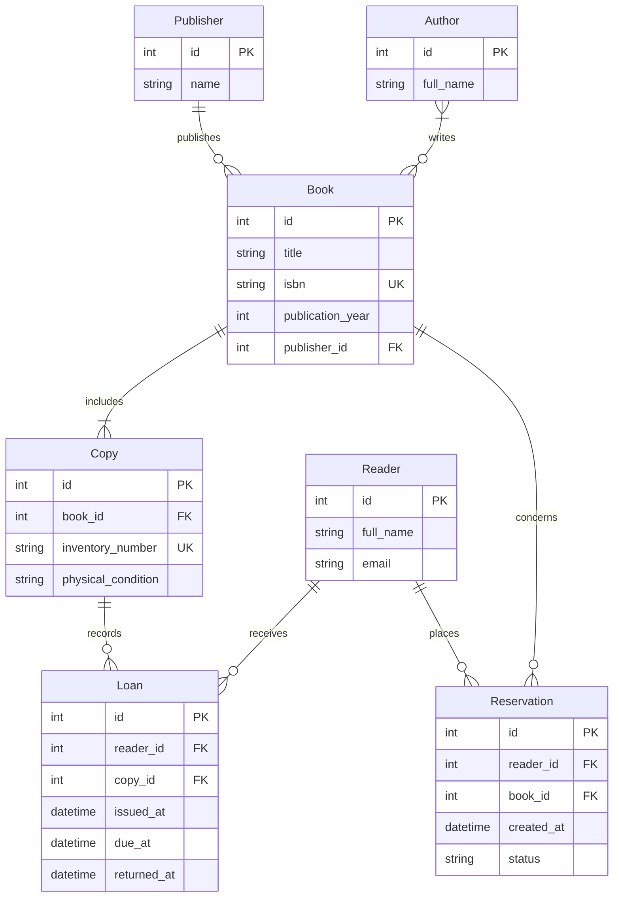

# Початкова відповідь першої генерації

Нижче наведено ER-модель за lab1-redo/spec.md із коміту 12ea998. Атрибути й типи є рішеннями AI-генерації, а не додатковими вимогами студента. Генерацію виконано в поточній сесії Codex із наявним попереднім контекстом; вона не є технічно ізольованою.

Рішення генерації:

- Ідентифікатори сутностей — цілі числа; FK мають такий самий тип, як відповідні PK.
- ISBN та інвентарний номер позначено альтернативними унікальними ключами.
- Author–Book представлено прямим M:N без додаткової сутності.
- Формулювання K2 «книга може щонайменше один фізичний примірник» витлумачено як мінімум один примірник у книги.
- Loan зберігає історію видач. returned_at допускає NULL до повернення; для Copy дозволена максимум одна відкрита видача. Це обмеження не виражається самою кардинальністю історії.
- Reservation зберігає бронювання Book незалежно від наявності вільних Copy. Для status запропоновано pending, fulfilled, cancelled. Активна черга складається з pending-записів, упорядкованих за зростанням id; id призначається в порядку створення бронювань.

Це початковий вихід генерації. Аудит, рендер, тести та виправлення не виконувалися. Специфікацію не змінено.
